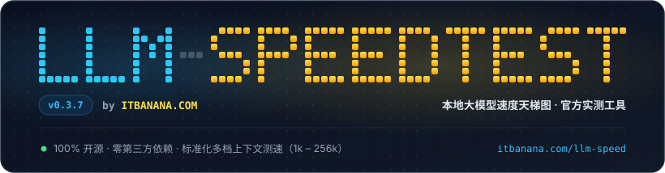

<div align="center">
  <a href="https://itbanana.com/llm-speed">
    <picture>
      <source media="(prefers-color-scheme: dark)" srcset="./assets/banner-dark.svg">
      <source media="(prefers-color-scheme: light)" srcset="./assets/banner-light.svg">
      
    </picture>
  </a>

  <p>
    <a href="https://itbanana.com/llm-speed"></a>
    
    
    
    <a href="./LICENSE"></a>
  </p>

  <p><b>A lightweight, open-source, zero-dependency tool for standardized local LLM inference speed testing</b></p>

  <p><a href="./README.md">简体中文</a> · <b>English</b></p>
</div>

> 🏆 **Get on the leaderboard as soon as you finish!**
> Want to know how your GPU / Mac ranks among the same hardware, how many `tok/s` you are behind the top result for your card, or how others squeeze out maximum speed? Run this tool once. It automatically runs a standardized benchmark across `1k / 32k / 64k / 128k / 256k` context sizes, and once you confirm the upload you appear **in real time** on the [Local LLM Speed Leaderboard (itbanana.com/llm-speed)](https://itbanana.com/llm-speed) and the [Local LLM Hardware Picker (itbanana.com/llm-hardware)](https://itbanana.com/llm-hardware):
> - 🏅 **See your rank among the same GPU and overall right away** (reaching #1 earns a dedicated champion card and a direct highlighted link)
> - 🏷️ **Optional display name and a one-line tuning recipe** (engine version, KV cache precision, MTP on/off, etc.) so you can show off your setup and let others copy it
> - 🔒 **100% measured on your own machine with hardware locked in**: credible, no fakes, no personal data collected
>
> 🧭 **No model installed yet?** No need to run anything first. Open the [Local LLM Hardware Picker (itbanana.com/llm-hardware)](https://itbanana.com/llm-hardware), choose your GPU and RAM, and see estimated speeds plus real results from the same hardware.

Works with any locally running OpenAI-compatible server (`llama.cpp`, `Strata`, `Basalt`, `vLLM`, `SGLang`, `Ollama`, `LM Studio`, `MLX`, `Project Maya`, and more).

> **Local machine only**: to keep hardware specs 100% trustworthy, the tool only allows testing on the machine that is running the model (`127.0.0.1` / `localhost` / the machine's own NIC IP). If your model runs on a remote Linux server, SSH into that server first and run the tool there.

> **Note**: the interactive terminal guide and the leaderboard site are currently in Chinese. Command-line flags (below) are language-neutral, so `--non-interactive` runs are easy to follow regardless.

---

## Quick Start (one command, no Git needed, straight to the leaderboard)

Git is not required. If Python 3.9+ is not installed, the script detects this and gives install instructions (`winget` on Windows, Homebrew on macOS, the system package manager on Linux).

**macOS / Linux:**
```bash
curl -fsSL https://raw.githubusercontent.com/oktothemoon/llm-speedtest/main/run.sh | bash
```

**Windows (PowerShell):**
```powershell
irm https://raw.githubusercontent.com/oktothemoon/llm-speedtest/main/run.ps1 | iex
```

<details>
<summary>Prefer not to pipe into a shell? Manual download / Git clone (so you can audit the source first)</summary>

**macOS / Linux (Git):**
```bash
cd ~ && if [ -d llm-speedtest/.git ]; then git -C llm-speedtest pull --ff-only || true; else git clone https://github.com/oktothemoon/llm-speedtest.git; fi && cd llm-speedtest && python3 speedtest.py
```

**Windows PowerShell (Git):**
```powershell
cd $HOME; if (Test-Path llm-speedtest\.git) { git -C llm-speedtest pull --ff-only } else { git clone https://github.com/oktothemoon/llm-speedtest.git }; if (Test-Path llm-speedtest\speedtest.py) { cd llm-speedtest; python speedtest.py }
```

Or click **Code → Download ZIP** at the top of the GitHub page, unzip, and run `python3 speedtest.py` in the folder (`python speedtest.py` on Windows).

</details>

After launch you get a guided terminal flow (works locally or over SSH): it detects your hardware, scans ports and models (and prompts for an API key if the server needs one) → runs the `1k / 32k / 64k / 128k / 256k` benchmarks → shows the scorecard and the plain-text JSON → optional display name / tuning note → confirm to upload and get your personal result card and a direct leaderboard link.

> 💡 **No model running on this machine?** Before exiting, the tool prints a link to the [Hardware Picker](https://itbanana.com/llm-hardware) so you can check estimated speeds first, then come back and run a real test once a model is installed. (It only prints the link and sends no data. In a local terminal, press Enter to open it in your browser; over SSH and with `--non-interactive` it only prints.)

---

## Advanced CLI Options (optional, mainly for scripts and AI agents)
| Option | Description |
|---|---|
| `--cli` | Go straight to terminal CLI mode (this is already the default) |
| `--endpoint URL` | Local OpenAI-compatible URL or port (e.g. `8080` or `http://127.0.0.1:8080/v1`); auto-scans if omitted |
| `--api-key KEY` | API key for the local server (optional, never uploaded; in interactive mode a 401 also triggers a prompt) |
| `--ctx 1k,32k,64k,128k,256k` | Input context sizes to test, comma-separated, `k` suffix supported (default: all; sizes beyond the server limit are skipped) |
| `--gen-tokens 256` | Max generated tokens per run (default `256`, same for every context size) |
| `--runs 3` | Runs per short-context size, median is reported (default `3`; sizes ≥64k always run once) |
| `--engine` / `--quant` / `--kv-cache` / `--mtp` | Inference engine, quantization, KV cache precision (`f16`/`bf16`/`fp8`/`int8`/`q8_0`/`q4_0`), and whether MTP is enabled |
| `--name` / `--note` | Optional public display name (≤20 chars) and one-line tuning note (≤120 chars) for the leaderboard; anonymous by default |
| `--anonymous` / `--client-id ID` | Do not attach the local random anonymous `client_id` / set a `client_id` manually (reuse your old record on a new machine) |
| `--ram-type` / `--ram-channels` | RAM generation (`DDR4`/`DDR5`, etc.) and channel count |
| `--detect-only` | Print the auto-detected hardware specs and exit |
| `--dry-run` / `--non-interactive` / `--yes` | Test without uploading / disable the interactive wizard / upload without confirmation |
| `--resubmit [file]` | Re-upload a previously saved result. Every result is saved automatically to `~/.config/llm-speedtest/results/` (`%APPDATA%\llm-speedtest\results\` on Windows), so you can resubmit later if an upload failed or you skipped it. Without a file, the latest result that was not uploaded successfully is used |

---

## Privacy (zero personal information — feel free to have your AI audit the source)

- **Never collected**: username, hostname, local file paths, command-line arguments, API keys, MAC address, GPU UUID, hardware serial numbers, environment variables.
- **Local random anonymous `client_id`**: on first run a purely random UUID is generated and stored locally (`~/.config/llm-speedtest/client_id`; it contains nothing about your machine or identity) so your results can be linked when you later upgrade your GPU/RAM or retune. Add `--anonymous` or delete the file to avoid attaching it.
- **Plain text before upload**: both the UI and the terminal show the exact JSON that will be sent, and by default nothing is uploaded until you confirm.
- **No raw IP stored server-side**: the server only uses a salted one-way hash for hourly rate limiting and de-duplication.
- **Zero third-party dependencies**: all code lives in two pure-Python standard-library files, `speedtest.py` and `ui.py`. If in doubt, hand them to your AI to review before running.

---

## Methodology

- One short warm-up request is sent first (not counted) so cold starts do not skew results.
- Each run's prompt starts with a different random run marker, preventing the engine from hitting its KV prefix cache and inflating prompt-processing speed.
- Exact `timings` returned by the engine (`predicted_per_second` / `prompt_per_second`) are preferred; the client-side SSE-measured `sse_tg_tps` is also recorded independently for server-side cross-checking.
- For Ollama the tool switches to the native `/api/chat` endpoint and reads the engine's internal timings (`prompt_eval_duration` / `eval_duration`), and reads the actually allocated context length from `/api/ps`; larger sizes are skipped automatically (Ollama's OpenAI-compatible endpoint silently truncates oversized input).
- When the server returns MTP / speculative-decoding draft stats (`draft_n` / `draft_n_accepted`), MTP is recorded as enabled along with the per-size draft acceptance rate. Strata / Basalt enable MTP by default; because the switch affects results enormously, you are asked to specify it if it cannot be confirmed.
- If several different GPU models all hold the model (e.g. RTX 5090 + RTX 5060 Ti), the result is tagged with `gpu_mix` as a mixed setup and is not ranked as a single card.
- Common modded large-VRAM cards are recognized automatically (e.g. `RTX 4090` + `48GB` maps to `rtx4090-48`).

## Running the Self-Tests

```bash
python3 -m unittest test_speedtest.py
# Windows:
python -m unittest test_speedtest.py
```

## License

MIT
