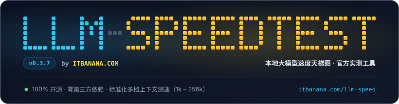

<div align="center">
  <a href="https://itbanana.com/llm-speed">
    <picture>
      <source media="(prefers-color-scheme: dark)" srcset="./assets/banner-dark.svg">
      <source media="(prefers-color-scheme: light)" srcset="./assets/banner-light.svg">
      
    </picture>
  </a>

  <p>
    <a href="https://itbanana.com/llm-speed"></a>
    
    
    
    <a href="./LICENSE"></a>
  </p>

  <p><b>轻量、开源、零第三方依赖的本机大模型推理速度标准化测试工具</b></p>
</div>

> 🏆 **测完即可实时上榜！**
> 想知道你的显卡 / Mac 在同款硬件里排第几、离同卡第一还差多少 `tok/s`、别人是怎么调出极限速度的？
> 跑一遍本工具，自动完成 `1k / 32k / 64k / 128k / 256k` 多档上下文标准化测速，确认上传后即可**实时登上 [本地大模型速度天梯图（itbanana.com/llm-speed）](https://itbanana.com/llm-speed)** 与 **[本地大模型配置选择器（itbanana.com/llm-hardware）](https://itbanana.com/llm-hardware)**：
> - 🏅 **立刻看到你的同卡排名 & 全榜排名**（登顶还有专属榜首战绩卡片与直达高亮链接）
> - 🏷️ **支持自由署名 & 留下一句话调优配方**（如引擎版本、KV Cache 精度、MTP 开关等），晒出你的神级调优，也让同卡玩家直接抄作业
> - 🔒 **100% 本机实测锁定硬件**，真实可信、零水分、零个人隐私采集

支持所有本机运行中的 OpenAI 兼容接口（`llama.cpp`、`Strata`、`vLLM`、`SGLang`、`Ollama`、`LM Studio`、`MLX`、`Project Maya` 等）。

> **仅限本机实测**：为保证硬件规格 100% 真实可信，本工具仅允许在运行大模型的本机测速（`127.0.0.1` / `localhost` / 本机网卡 IP）。如果模型跑在远端 Linux 服务器上，请先 SSH 登录后直接在该服务器上运行。

---

## 快速开始（一条命令，免 Git，测完直接冲榜）

无需预先安装 Git；如果本机尚未安装 Python 3.9+，脚本会自动检测并给出中文安装指引（Windows 支持 `winget` 一键安装，macOS 支持 Homebrew，Linux 支持系统包管理器）。

**macOS / Linux：**
```bash
curl -fsSL https://raw.githubusercontent.com/oktothemoon/llm-speedtest/main/run.sh | bash
```

**Windows（PowerShell）：**
```powershell
irm https://raw.githubusercontent.com/oktothemoon/llm-speedtest/main/run.ps1 | iex
```

<details>
<summary>不想管道运行？查看手动下载 / Git 克隆运行方式（方便先审计源码）</summary>

**macOS / Linux（Git）：**
```bash
cd ~ && if [ -d llm-speedtest/.git ]; then git -C llm-speedtest pull --ff-only || true; else git clone https://github.com/oktothemoon/llm-speedtest.git; fi && cd llm-speedtest && python3 speedtest.py
```

**Windows PowerShell（Git）：**
```powershell
cd $HOME; if (Test-Path llm-speedtest\.git) { git -C llm-speedtest pull --ff-only } else { git clone https://github.com/oktothemoon/llm-speedtest.git }; if (Test-Path llm-speedtest\speedtest.py) { cd llm-speedtest; python speedtest.py }
```

或者直接点击页面上方 **Code → Download ZIP** 下载源码，解压后在目录中运行 `python3 speedtest.py`（Windows 下为 `python speedtest.py`）。

</details>

运行后会出现中文引导菜单（支持 `↑`/`↓` 方向键切换或直按 `1`/`2`）：
- **`[1]` 终端直接测速（默认）**：适合本机或 SSH 终端，自动识别本机硬件、扫描端口与模型（如服务设置了 API Key 会直接引导输入）→ 自动跑 `1k / 32k / 64k / 128k / 256k` 测速 → 查看成绩单与明文 JSON → 选填署名/调优备注 → 确认上传并生成专属上榜战绩卡片与天梯直达链接。
- **`[2]` 打开本地 WebUI 页面**：仅监听 `127.0.0.1`、自动在浏览器打开，点点鼠标即可完成多档测速与带礼花动效的上榜提交。

也可以通过参数直接进入对应模式：
- `python3 speedtest.py --cli`（Windows 下 `python speedtest.py --cli`）：直接进入终端模式
- `python3 speedtest.py --ui`：直接启动本地 WebUI 页面

---

## 进阶命令行参数（可选，主要供脚本与 AI 使用）
| 参数 | 说明 |
|---|---|
| `--cli` / `--ui` | 直接进入终端命令行模式 / 直接打开本地 WebUI 页面 |
| `--endpoint URL` | 本机 OpenAI 兼容地址或端口号（如 `8080` 或 `http://127.0.0.1:8080/v1`，不填则自动扫描） |
| `--api-key KEY` | 本机推理服务 API Key（选填，绝不上传；交互模式下遇到 401 也会自动提示输入） |
| `--ctx 1k,32k,64k,128k,256k` | 要测试的输入上下文档位，逗号分隔、支持 `k` 缩写（默认全测，超限档位自动跳过） |
| `--gen-tokens 256` | 每轮生成 token 上限（默认 `256`，各上下文档位统一） |
| `--runs 3` | 短上下文每档测速轮数，取中位数（默认 `3`；≥64k 自动 1 轮） |
| `--engine` / `--quant` / `--kv-cache` / `--mtp` | 推理引擎、量化版本、KV Cache 精度（`f16`/`bf16`/`fp8`/`int8`/`q8_0`/`q4_0`）、是否开启 MTP |
| `--name` / `--note` | 选填：天梯图公开署名（≤20 字）与一句话调优备注（≤120 字），不填默认匿名 |
| `--anonymous` / `--client-id ID` | 不附带本地随机匿名 `client_id` / 手动指定 `client_id`（换新机时可沿用旧记录） |
| `--ram-type` / `--ram-channels` | 内存代数（`DDR4`/`DDR5` 等）与通道数 |
| `--detect-only` | 仅打印本机自动识别的硬件规格并退出 |
| `--dry-run` / `--non-interactive` / `--yes` | 仅测不传 / 关闭交互向导 / 免确认直接上传 |

---

## 隐私说明（零个人信息，欢迎交给你的 AI 审计源码）

- **绝不采集**：用户名、主机名、本地文件路径、命令行参数、API Key、MAC 地址、GPU UUID、硬件序列号、环境变量。
- **本地随机匿名 `client_id`**：首次运行时会在本地生成并保存一个纯随机 UUID（`~/.config/llm-speedtest/client_id`，不含任何机器或个人隐私），方便你日后升级显卡/内存或调优后再测速时关联历史成绩；如需完全不附带可加 `--anonymous` 或删除本地文件。
- **上传前明文可见**：界面和终端都会完整展示即将发送的 JSON，默认需你手动确认才会上传。
- **服务端不保存原始 IP**：接收端仅使用加盐单向哈希做每小时限流与同机去重。
- **零第三方依赖**：全部代码只有 `speedtest.py` 和 `ui.py` 两个纯 Python 标准库文件，不放心可以直接丢给你的 AI 检查源码后再运行。

---

## 测试方法说明

- 先发 1 次短预热请求（不计入成绩），避免冷启动影响。
- 每轮 prompt 开头带有不同的随机轮次标识，防止引擎命中 KV 前缀缓存导致读题速度虚高。
- 优先读取引擎精确返回的 `timings`（`predicted_per_second` / `prompt_per_second`），同时独立记录客户端 SSE 流式测算的 `sse_tg_tps` 供服务端交叉校验。
- 自动识别常见魔改大显存卡（例如根据 `RTX 4090` + `48GB` 显存自动映射为 `rtx4090-48`）。

## 运行自测

```bash
python3 -m unittest test_speedtest.py
# Windows:
python -m unittest test_speedtest.py
```

## License

MIT
